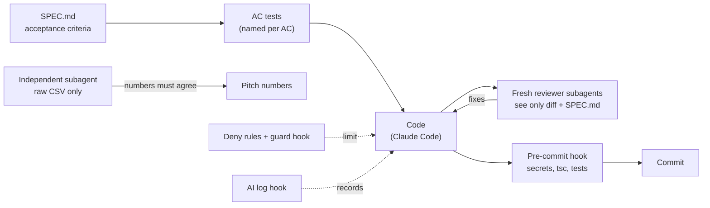

# AI log

How AI was used to build Fulcrum at the Adapty Hackathon Belgrade (7 to 8 Nov 2026), and what we changed, rejected and verified. Times are Europe/Belgrade.

## How we built it

- **Spec, then tests, then code.** Every rule is an acceptance criterion in [SPEC.md](SPEC.md) with a test named after it, written before the implementation.
- **Deny rules and a guard hook.** The coding agent cannot call Adapty's 27 MCP write tools or any CLI write command, and cannot read the secrets file ([.claude/settings.json](.claude/settings.json), [.claude/hooks/guard.sh](.claude/hooks/guard.sh)).
- **Pre-commit hook.** A commit lands only if it has no secrets, `tsc --noEmit` is clean and every test passes ([.githooks/pre-commit](.githooks/pre-commit)).
- **Reviewer subagents.** Before key commits a fresh subagent that saw only the diff and SPEC.md answered three questions: can the agent bypass the gate, can the token leak, is the boundary right (table below).
- **Independent recomputation.** A subagent with no access to our code re-computed the pitch numbers from the raw CSV: the money estimate is $19.4k in our implementation and $17.5k in its matched-cohort check, so we say "about $19k".
- **AI log hook.** A `PostToolUse` hook appends every edit and command, secrets redacted, to a local gitignored log; this file is the public summary ([.claude/hooks/ai-log.sh](.claude/hooks/ai-log.sh)). The design follows Vir, Djordje's own session-distillation CLI (pre-existing, not part of Fulcrum): capture raw session events, then distill them into a short human-readable record; here a checkpoint after each phase does the distilling.

## Harness, tools and MCPs

- **Claude Code (desktop app)** is the only coding tool; each piece of work runs in its own git worktree. A two-layer CLAUDE.md (personal rules plus this repo's [CLAUDE.md](CLAUDE.md), with private event context kept out of git) sets the rules.
- **Model split:** reviewers ran on a different model than the builder (Fable for the gate, server and data; Sonnet for the builder check and security re-reviews), so they do not share its blind spots. An automated security-review plugin ran on security-relevant commits.
- **Skills:** Superpowers workflow skills set the order (design → SPEC.md → task plan → test-first tasks); personal skills `phase-checkpoint` (Djordje explains each phase back before the next) and `demo-preflight` (read-only checks before the demo).
- **The guard is client-side policy, not the security boundary.** It was hardened over three review rounds, then deliberately stopped: a text-matching guard cannot fully parse shell. The real boundary is that only the Fulcrum process holds `ADAPTY_TOKEN`.

| MCP server | Who uses it | Why |
|---|---|---|
| **Fulcrum** (ours, stdio, [src/mcp/server.ts](src/mcp/server.ts)) | the demo agent, as its **only** server ([demo/.mcp.json](demo/.mcp.json)) | Reads, verdicts, replays, `request_stop` and `propose_test`, which only create pending actions. There is no approve tool: a human approves in the browser. |
| **Adapty MCP** (`https://mcp.adapty.io/mcp`) | the coding agent, read-only | Fast reads of the seeded app while building; all write tools denied. |

Fulcrum calls Adapty through the CLI, not Adapty's MCP: the MCP is built for an AI client with browser OAuth, and Fulcrum must be a plain server process that alone holds the token.

## Prompts that worked

Shortened paraphrases; the point is what each brief withholds or narrows.

1. **Isolated cross-check.** "You have no project context. Read only the CSVs at <path>. For each A/B test, define revenue per install at the goal horizon, compute it per arm at every weekly look, and report when |z| crosses 2.1 × sqrt(15/k). State your definitions." Giving it none of our numbers is what made its disagreement on Settings believable.
2. **Three-question reviewer.** "You see only this diff and SPEC.md. With file:line evidence or a reproduction: can the agent reach an Adapty write without a named human approval, can the token reach any output or log, is the boundary computed as the spec says." Narrow questions found real bugs (double pending actions, self-approval with `curl`) instead of style notes.
3. **Builder check.** "Read only this design document. What would you still need to know before writing a plan? Questions, not suggestions." It turned an implicit design into 8 explicit decisions.

## Independent reviews

Every reviewer was a fresh Claude subagent that saw only what is listed (never the conversation, the secrets file or Adapty access).

| When (Sat) | Reviewer | Saw / asked | Found | What changed |
|---|---|---|---|---|
| ~12:05 | subagent, raw CSV only | re-compute the pitch numbers | Onboarding week 9 and the Settings end agree; ≈ $19.4k; "Settings as of 2 Sep" does not hold (p 0.26) | 2 Sep scene dropped |
| ~12:25 | Fable, raw CSV only | Settings, every look, five metrics | one naive-significant lead (16 Aug, fragile); boundary never crossed | demo rebuilt around 16 Aug and Onboarding "not yet, then now" |
| ~12:40 | Sonnet, design doc only | what is missing before a plan | 8 open questions | all answered in the [demo design](docs/superpowers/specs/2026-11-07-fulcrum-demo-design.md) |
| ~13:40 | Fable + security plugin | approval gate | duplicate pending actions; approvable before the ledger write | slot reserved first, ledger first |
| ~14:30–15:00 | Sonnet + Fable + security plugin | approval page | **the agent could approve its own request with `curl`**; reusable login link | single-use login, session cookie, CSRF, Origin/Host checks |
| ~15:00–15:45 | Sonnet + security plugin | demo agent isolation | agent could edit Fulcrum, plant a fake `tsx` or a hostile `tsconfig.json` | OS sandbox, write-denied loader files, regression test |
| ~16:00–17:00 | Sonnet + Fable | verdict engine | looks anchored on time of day | day-aligned looks (week 9 z 4.49 → 4.34, same verdict); the spec moved, not the tolerance |
| ~17:00–18:10 | Fable + Sonnet + security plugin | closed loop, attacks, demo safety | live-test rule matched titles; backup port not forwarded | match by placement id (fails closed); port-only env |

**Known limits, said openly:** on one machine and one OS user, a determined local process could read the one-time login code in its 60 s window, and the agent runs as the same OS user as Fulcrum. In production Fulcrum would run as a separate service under its own user, with approvals on a separate channel.

## Phases

### Phases 1–2: the only door, and real verdicts (Sat 10:10–16:40)

- **Goal:** the only door (AC-BYPASS, AC-TOKEN) and verdicts on the declared goal with a calibrated boundary (AC-PEEK, AC-SHOP, AC-CALIB).
- **What AI produced:** the MCP server, the token kept inside Fulcrum, the gate, ledger and human-only approval page, the sandboxed demo agent; the CSV loader, revenue per install, the boundary and its simulation, the verdict engine. In my words: "the agent has no token, it only has requests"; "no user has done 60 days, until that is accomplished it's always not yet"; "Fulcrum adds it in code, Adapty's MCP is just a prompt."
- **What I changed or decided:** the Settings scene moved from 2 Sep to 16 Aug after the independent check; the positioning narrowed to "the only door"; the activity log stays private.
- **Verification:** 140 tests then; every task independently reviewed (table above); pitch numbers re-derived independently.
