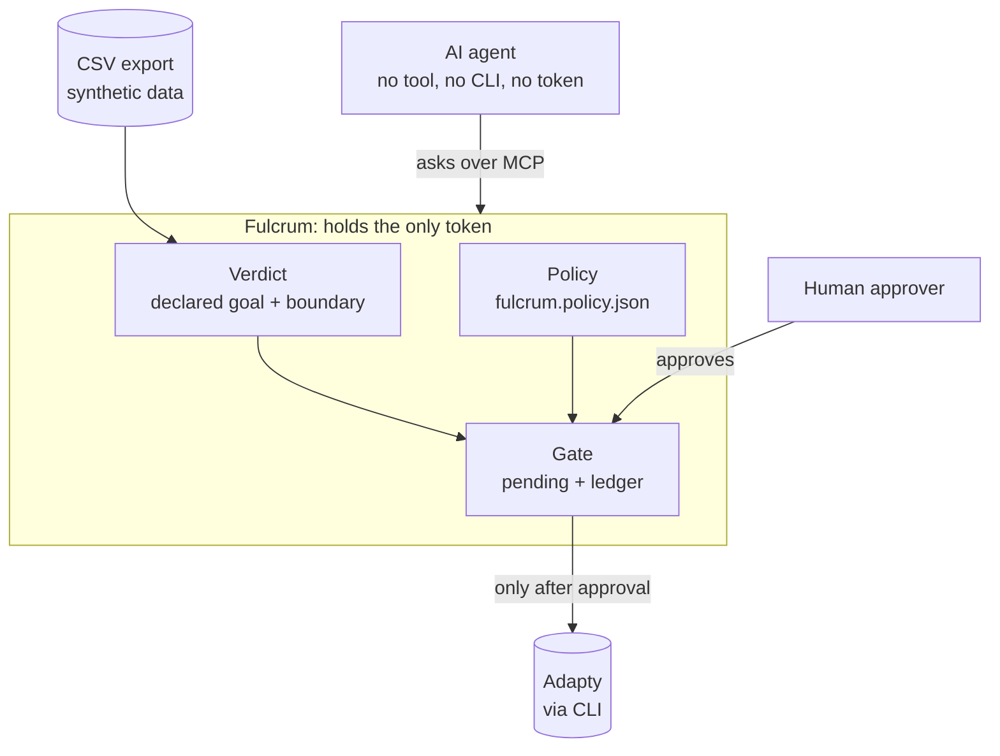
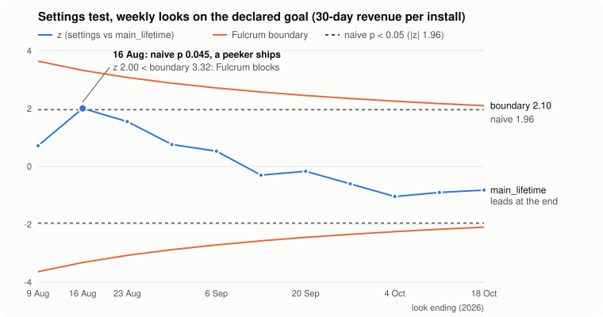

# Fulcrum

[](https://github.com/djolex999/fulcrum/actions/workflows/ci.yml)

**2nd place, Adapty First Commit hackathon, Belgrade 2026.**

Fulcrum is the only door between an AI agent and an Adapty account: the agent can read and propose, but every change passes policy, statistics and a human approval before Fulcrum executes it.

- **Demo video (2 min):** [youtu.be/kvZbSLL6XP4](https://youtu.be/kvZbSLL6XP4)
- **Landing page:** [djolex999.github.io/fulcrum-site](https://djolex999.github.io/fulcrum-site/) ([source](https://github.com/djolex999/fulcrum-site))
- **Built and tested:** 199 tests (`npm test`, run in CI on the pinned dataset), plus a bypass and abuse suite (`npm run test:attacks`).

## What it does

- **The agent has no Adapty token and no CLI.** Its only MCP server is Fulcrum ([demo/.mcp.json](demo/.mcp.json)); Adapty's own MCP write tools and `adapty` CLI writes are denied for it. Fulcrum is the only process that holds `ADAPTY_TOKEN`.
- **The MCP server is its only write path, and none of its tools writes.** `request_stop` and `propose_test` only create pending requests. There is no approve tool.
- **Every action is checked against [`fulcrum.policy.json`](fulcrum.policy.json)** and the test's declared goal: allowed placements, a traffic cap on the challenger, no live test on the placement, a daily write limit, and a sequential stopping boundary for stops.
- **A human approves on a local page the agent can't reach** (127.0.0.1, single-use login link, session cookie, CSRF and Origin/Host checks). Fulcrum judges the request again at approval time and runs the Adapty CLI only if the verdict still holds. A proposed test is created as a draft; starting it stays a human action in Adapty.
- **Every attempt goes into an append-only ledger**, blocked or approved, with the reason, time and the approver's name.
- **It fails closed.** A missing or invalid policy file blocks every proposal; if live tests on a placement can't be verified, the proposal is blocked; a pending request expires after 30 minutes; a CLI error marks the action failed and nothing is retried.



The agent's tools: `list_tests`, `judge_test`, `test_timeline`, `find_signals`, `request_stop`, `propose_test`, `request_status`.

## Why it matters

An agent that checks a test every hour is the perfect machine for the classic A/B testing mistakes. On the hackathon's synthetic Lumen app:

- **Peeking.** Checking weekly and stopping at p < 0.05 finds a fake winner in about 22% of A/A tests (22.7% over 200,000 simulated tests). Fulcrum's boundary, c·√(K/k) with c = 2.1 and K = 15 looks, cuts that to about 5% (5.2%); c is calibrated by simulation. In the replay, a peeking agent would have shipped the Settings paywall on 16 Aug (naive p 0.045, z 2.00 against a boundary of 3.32); by the end the other arm leads.
- **Metric shopping is refused.** A test is judged only on its declared goal. Asking to stop Settings on payer rate instead of revenue returns `METRIC_NOT_GOAL`.
- **A real winner ships on time.** Onboarding's goal is 60-day revenue, so week 2 is "not yet" and week 9 is the first valid look. It crosses there (z 4.34 vs 2.71), so it ships at week 9 instead of running on: about $19k on a synthetic dataset.

<picture>
  <source media="(prefers-color-scheme: dark)" srcset="docs/img/peeking-dark.svg">
  
</picture>

Run `npm run demo:story` to reproduce every number above (`npm run readme:chart` redraws this chart from the same data). All of them come from the synthetic export (`export_csv`), not from real revenue.

**Why AI:** the statistics are deterministic code on purpose, since a stopping rule a model could talk itself past would be worthless. The agent does the growth work (reads the data, finds the next hypothesis, proposes a test, explains verdicts), and every "no" or "not yet" it gets back carries the numbers and the next step.

## How it was built

Built during the hackathon weekend with Claude Code. Details in [AI_LOG.md](AI_LOG.md).

- **Spec first, with AC tests.** Every rule is an acceptance criterion in [SPEC.md](SPEC.md) with a test named after it, written before the code.
- **An attack suite.** `npm run test:attacks` tries direct Adapty writes, token leaks, metric shopping and repeated requests.
- **Fresh reviewer agents** that saw only the diff and the spec, asked three questions: can the agent bypass the gate, can the token leak, is the boundary right. One found that the agent could approve its own request with `curl`; it was patched with a single-use login, session cookie, CSRF and Origin/Host checks, plus a test.
- **An independent recalculation** by an agent with no access to our code, only the raw CSV. It showed that the planned centerpiece scene did not hold up (p 0.26), so it was cut, and confirmed the week 9 crossing and the money estimate.
- **[AI_LOG.md](AI_LOG.md)** is the public summary; a `PostToolUse` hook ([.claude/hooks/ai-log.sh](.claude/hooks/ai-log.sh)) records every edit and command locally with secrets redacted. A pre-commit hook blocks secrets, type errors and failing tests.

## Quickstart

Needs Node 22+ and the public synthetic Lumen dataset at this exact path:

```bash
git clone https://github.com/kpotehin/adapty-seed-data-hack ~/Projects/adapty-seed-data-hack
```

```bash
git clone https://github.com/djolex999/fulcrum && cd fulcrum
```

```bash
npm ci && npm run demo:story
```

```bash
npm test && npm run test:attacks
```

`demo:story` prints the whole story offline (the 16 Aug peeking trap, the simulation, Onboarding "not yet, then now") with no Adapty account and no token. It and the tests read the dataset from `~/Projects/adapty-seed-data-hack/data/offline`.

To run the agent against a real Adapty account: put `ADAPTY_TOKEN` in `.env` (see `.env.example`), then `cd demo && CLAUDE_CONFIG_DIR="$HOME/.claude-fulcrum-demo" claude`. Fulcrum is the agent's only MCP server and reads the token itself; the agent never sees it. The prompts are in [demo/PROMPTS.md](demo/PROMPTS.md).

## Limitations

- **Verdicts are a replay on the CSV export.** Live `adapty_metrics` (today's users) is not wired in; asking for it returns `NOT_IMPLEMENTED`. *In production:* judge on live Adapty metrics, with the CSV kept for replays.
- **Gate state is in memory.** Restarting Fulcrum drops pending requests; the ledger on disk is kept. *In production:* pending actions in a database next to the ledger.
- **One approver, identified by a typed name.** Proposed tests require a name listed in `approvers`; stop approvals record the typed name but don't check the list. The page is local and protected by a one-time login, not by user accounts. *In production:* real sign-in, per-action approver lists, approvals in Slack.
- **Isolation depends on the agent's client config.** The demo agent's MCP config, deny rules, sandbox and a guard hook keep it away from Adapty, and it runs as the same OS user as Fulcrum. *In production:* Fulcrum runs as a separate service under its own user, so the agent's machine never holds the token.
- **Policy's `fallbackHorizonDays` is not read yet.** Every test plan must declare its horizon.
- **`fallbackK` is read at startup.** Changing it while a test without K in its plan is running changes that test's boundary for the remaining looks. *In production:* K is fixed per test when it starts.

## Disclosure

- **Pre-event work:** we analyzed the public Lumen demo dataset before the event to understand its shape. No code or data from that analysis is reused here.
- **Made before kickoff:** a break-time display screen, a draft slide deck, a draft spec (SPEC.md), the AI log tooling (`.claude/hooks/ai-log.sh` and its test) and a guard hook for the coding agent (`.claude/hooks/guard.sh` and its test).
- **Pre-existing personal tooling**, not part of the project core: Claude Code skills (`phase-checkpoint`, `demo-preflight`), hooks, and Vir (Djordje's own session-distillation CLI).
- **AI tools:** Claude Code, including fresh reviewer subagents. The landing page was designed with Claude Design during the event and lives in a separate repo.
- **Data:** synthetic only, from the Lumen demo app provided for the hackathon. No real user data.

## Why "Fulcrum"

An AI agent is a lever for a growth team, but a lever without a fixed point just swings. The fulcrum is the point that doesn't move: the declared goal, the stopping boundary and a human approval.

## Team

- **Djordje Marković** (engineering): spec, code, tests and the AI harness.
- **Milica Petković** (data): verified the numbers and handled the data.

## License

MIT, see [LICENSE](LICENSE).
