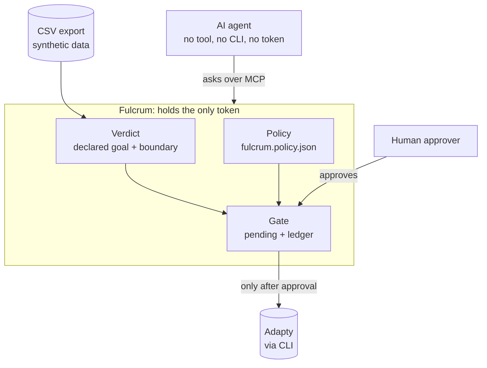

# Fulcrum

> **Status (Sun 8 Nov, code freeze):** built and tested (194 tests, `npm test`): the MCP server and the only door (no tool, no CLI, no token for the agent), the approval gate and ledger, the human-only approval page, the verdict engine (declared goal, horizon, sequential boundary, `as_of` replay, metric-shopping refusal), and the closed loop: `find_signals` and `propose_test`, which after human approval creates a new test as a draft (starting it stays a human action in Adapty), under `fulcrum.policy.json`. `npm run demo:story` prints the evidence; `npm run test:attacks` runs the bypass and abuse tests.

**Agents peek, and peeking costs money both ways.** On the hackathon's synthetic Lumen app, a weekly-peeking agent would have shipped the wrong paywall on 16 Aug (naive p 0.045, just under 0.05, while z was 2.00 against a stopping boundary of 3.32; by the end the other arm leads), and left a real winner worth about $19k running weeks too long (Onboarding clears the boundary at week 9). Fulcrum fixes both: it blocks fake winners and releases real ones at the first valid look. The peeking risk is calibrated by simulation: about 22% false wins with naive weekly looks vs about 5% with the boundary. All numbers are `export_csv` (synthetic data), reproduced by `npm run demo:story`.

Safety is what lets an agent be trusted to make that money. Fulcrum is the only door between AI agents and an Adapty account: the agent has no write tool and no token. Fulcrum is the only process that can write to Adapty, and it writes only after policy, statistics and a named human. Agents can read test data; every change passes the test's declared goal, a sequential stopping boundary and a human approval, and only then does Fulcrum execute it.

**How we built it with AI:** spec, then tests, then code, with reviewer subagents and an independent recomputation of every number. See [AI_LOG.md: How we built it](AI_LOG.md#how-we-built-it).

**Landing page:** [djolex999.github.io/fulcrum-site](https://djolex999.github.io/fulcrum-site/), the one-page overview with the three demo moments ([source](https://github.com/djolex999/fulcrum-site)).

## Why "Fulcrum"

Archimedes said that with a lever and a place to stand he could move the world. AI agents are that lever for a growth team: one prompt, and an agent can stop a test, ship a paywall and move real revenue. But a lever without a fixed point doesn't move anything. It just swings.

An A/B test looks the same: a beam with arm A on one side and arm B on the other, tipping a little every time new users arrive. Peeking is mistaking one of those wobbles for the beam settling. The fulcrum is the one point that doesn't move: the declared goal, the stopping boundary and a human approval. Everything the agent does pivots on it. That is Fulcrum: the fixed point that turns an agent's leverage into money instead of noise.

## The problem

Growth teams running paywall and onboarding A/B tests routinely:

- stop tests too early, before enough data has come in;
- misread winners, treating noise or a short-lived lift as a real effect;
- peek at results repeatedly, which inflates the rate of false wins (calibrated by simulation: about 22% false wins with naive weekly looks vs about 5% with the boundary).

The result is shipped "winners" that never actually won.

**Who it is for:** the growth or product lead of a subscription app who lets an AI agent run paywall tests, and today stops them by hand or trusts the agent's confirmation prompt.

## Why this matters for Adapty

Adapty just gave agents write access: its MCP server has 27 write tools, and before a start or stop it asks the model to confirm. Adapty also earns a share of its customers' revenue, so a wrong test decision costs Adapty too. Fulcrum is the policy layer that makes turning on agent writes safe: declared goals, a calibrated stopping boundary, policy as code and a human approval, in front of the CLI. It speaks MCP, so it works with any MCP client, not one agent.

## Why AI

The statistics are deterministic code on purpose: a stopping rule that a model could talk itself past would be worthless. The AI is the agent doing the growth work: reading the data, finding the next hypothesis (5+ AI edits on day one pay about twice as often), proposing the test and explaining verdicts in plain language. Fulcrum's replies are designed for that agent, not for a dashboard reader: every "no" or "not yet" carries the numbers behind it and the next step (the next valid look, the declared goal to ask about, who approves and where).

## How it works

- **Approval gate:** the agent has no token, it only has requests. A request becomes pending only if the statistics say there is a winner for that exact arm, and only a human clicking Approve on the local page makes Fulcrum stop the test. Adapty's own MCP asks the model to confirm before a stop, which is just a prompt; Fulcrum adds the rule in code, plus statistics, a human approver and a ledger of every attempt.
- **Verdict engine:** a test is judged only on its declared goal. For Onboarding that is 60-day revenue per install, so until users have been in the app for 60 days the answer is always "not yet"; the first week anyone qualifies is week 9, and that is where it crosses the boundary.
- **Agent loop:** the agent reads tests and asks for verdicts through Fulcrum's tools; every reply ends with the next step. It can also find a signal in the data (`find_signals`: users with 5+ AI edits on day one pay about twice as often) and propose a new test through the same door (`propose_test`).
- **Policy plus draft:** the agent can propose, but policy decides what it may propose, and it can never start a test. Every proposal is checked against `fulcrum.policy.json` (allowed placements, a traffic cap on the challenger, no live test on the placement, a daily write limit), and only a listed approver can approve it. The reply shows the rules it passed, who may approve, and any existing draft on the placement (on `ai_limit_reached`, "AI limit: Pro vs 3 plans"). After approval Fulcrum creates the test once, **as a draft**; starting it stays a human action in Adapty, and Fulcrum has no start tool.
- **Stopping boundary:** at look k of K planned weekly looks, a test may stop only if |z| on its declared goal exceeds c × √(K/k). Early looks need overwhelming evidence; the bar falls to c at the last look. c = 2.1 for K = 15 is calibrated by simulating A/A tests (no real difference): weekly peeking at p < 0.05 calls a false winner about 22% of the time; the boundary, about 5%. K and the horizon come from the test plan (`test-plans.json`), with a visible fallback.

## The demo, in order

The refusals are the point, not the approval button: four "no" or "not yet" answers come before the one write.

1. **No direct path.** `/mcp` lists only Fulcrum; the agent's `adapty ab-tests stop` in Bash is denied.
2. **Settings, replayed as of 16 Aug 2026: blocked by the boundary.** On its declared goal (30-day revenue per install) naive p was 0.045, just under 0.05, so a weekly-peeking agent would have shipped it; z was 2.00 against a boundary of 3.32. By the end the other arm leads.
3. **Payer rate instead: refused** as metric shopping. Only the declared goal can be judged.
4. **Onboarding replay:** week 2 "not yet" (no user has 60 days), week 9 "now" (z 4.34 against 2.71). Shipping at week 9 is worth about $19k on this synthetic app.
5. **Only then approval and the live stop.** A human approves on the local page and Fulcrum stops the test in Adapty.
6. **The next test.** The agent finds the 5+ AI edits signal and proposes a test on `ai_limit_reached`: policy check, approval, draft only.

The prompts are in [demo/PROMPTS.md](demo/PROMPTS.md).

## Architecture



The agent's tools: `list_tests`, `judge_test`, `test_timeline`, `find_signals`, `request_stop`, `propose_test`, `request_status`. None of them writes; a write happens only after the gate gets a human approval.

## Run it

```bash
npm ci && npm run demo:story
```

Prints the whole story offline from the synthetic data, with no Adapty access and no token: the Settings peeking trap, the 22% vs 5% simulation, and the Onboarding "not yet, then now" timeline. It reads the public Lumen dataset from `~/Projects/adapty-seed-data-hack/data/offline` (clone [kpotehin/adapty-seed-data-hack](https://github.com/kpotehin/adapty-seed-data-hack) into `~/Projects`).

- `npm test` runs all 194 tests; `npm run test:attacks` runs the bypass and abuse suite.
- To run the agent: put `ADAPTY_TOKEN` in `.env` (see `.env.example`), then `cd demo && CLAUDE_CONFIG_DIR="$HOME/.claude-fulcrum-demo" claude` (a clean config, so the agent sees none of your own skills or instructions). Fulcrum is the agent's only MCP server and reads the token from the repo's `.env` itself; the agent never sees it.

## Limitations

- **Synthetic data.** All numbers come from the public synthetic Lumen dataset (`export_csv`). The live stop is judged on that offline export; live `adapty_metrics` (about 1,000 of today's users) is not wired in yet.
- **Isolation is client policy plus token absence.** The demo agent has no Adapty tool, no CLI write and no token; its only path to a write is Fulcrum. On one machine and one OS user this is enforced by Claude Code's sandbox, deny rules and a hook. In production Fulcrum would run as a separate service that holds the token.
- **Approval page.** Local only (127.0.0.1), one human approver, a one-time login link; no multi-user auth.
- **Gate state is in memory.** Restarting Fulcrum drops pending requests (the ledger on disk is kept).
- **Pending requests expire after 30 minutes.** A stop is judged again when the human approves, and runs only if the verdict still holds.
- **Drafts only.** `propose_test` creates a new test as a draft after approval; starting it is a human action in Adapty.

## Real vs mocked

- **Real:** the Fulcrum MCP server, the approval gate and ledger, the approval page, the verdict engine and boundary, and the Adapty writes. A real Claude Code agent was blocked, replayed and approved through Fulcrum, and Fulcrum stopped real (throwaway) tests in a real Adapty account through the Adapty CLI.
- **Synthetic:** the data. Verdicts are computed on the hackathon's synthetic Lumen export (50,000 users); no real user data. The money figure (about $19k) is on that synthetic data.
- **Not built:** live verdicts on `adapty_metrics`, multi-user approval, and Fulcrum as a separate hosted service.

## What's next

- Live verdicts on `adapty_metrics` next to the CSV export.
- Fulcrum as a hosted service under its own OS user, with approvals in Slack.
- Per-test K and horizon from each test plan, and boundaries for Adapty's P2BB.

## Built with

- Adapty CLI (Fulcrum calls Adapty through it)
- Model Context Protocol (`@modelcontextprotocol/sdk`): Fulcrum is an MCP server for the agent
- Claude Code: the agent in the demo (connected to Fulcrum over MCP) and the build tool
- TypeScript on Node 22, Hono, Vitest

## Disclosure

- **Pre-event work:** we analyzed the public Lumen demo dataset (`adapty-seed-data-hack`) before the event to understand its shape. No code or data from that analysis is reused in this repository.
- **Made before kickoff:** a break-time display screen, a draft slide deck, a draft spec (SPEC.md), and the AI log tooling (AI_LOG.md, the `.claude/hooks/ai-log.sh` hook and its test), and a guard hook for the coding agent (`.claude/hooks/guard.sh` and its test).
- **Pre-existing personal tooling**, not part of the project core: Claude Code skills (`phase-checkpoint`, `demo-preflight`), hooks, and Vir (Djordje's own session-distillation CLI).
- **AI tools:** Claude Code, including fresh reviewer subagents that see only the diff and the spec. The landing page was designed with Claude Design during the event and lives in a separate repo.
- **Boilerplate / third-party starters:** none.

## Data

Demo and synthetic data only, from the Lumen demo app provided for the hackathon. No real user data.

## Team

**Fulcrum**

- **Djordje Marković:** built everything (spec, code, tests, harness), working with Claude Code.
- **Milica Petković:** verified the numbers, wrote the pitch and Q&A, presents the demo and plays the human approver.

## License

MIT, see [LICENSE](LICENSE).
