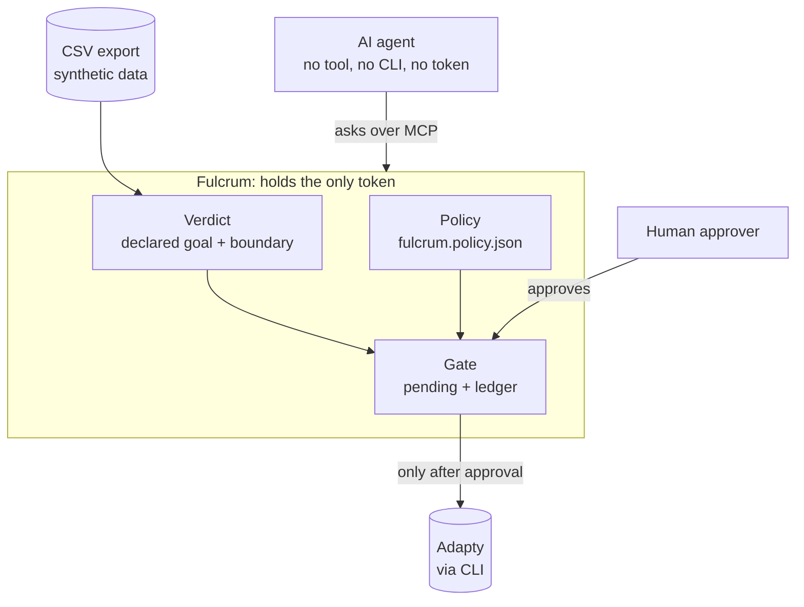

# Fulcrum

> **Status (Sat 7 Nov, evening):** built and tested (188 tests, `npm test`): the MCP server and the only door (no tool, no CLI, no token for the agent), the approval gate and ledger, the human-only approval page, the verdict engine (declared goal, horizon, sequential boundary, `as_of` replay, metric-shopping refusal), and the closed loop: `find_signals` and `propose_test`, which after human approval creates a new test as a draft (starting it stays a human action in Adapty), under `fulcrum.policy.json`. `npm run demo:story` prints the evidence; `npm run test:attacks` runs the bypass and abuse tests.

Fulcrum is the only door between AI agents and an Adapty account. There is no tool, no CLI and no token for the agent: its only path to a write is Fulcrum. Agents can read test data; every change passes the test's declared goal, a sequential stopping boundary and a human approval, and only then does Fulcrum execute it.

**Landing page:** [djolex999.github.io/fulcrum-site](https://djolex999.github.io/fulcrum-site/), the one-page overview with the three demo moments ([source](https://github.com/djolex999/fulcrum-site)).

## The problem

Growth teams running paywall and onboarding A/B tests routinely:

- stop tests too early, before enough data has come in;
- misread winners, treating noise or a short-lived lift as a real effect;
- peek at results repeatedly, which inflates the rate of false wins.

The result is shipped "winners" that never actually won.

## How it works

- **Approval gate:** the agent has no token, it only has requests. A request becomes pending only if the statistics say there is a winner for that exact arm, and only a human clicking Approve on the local page makes Fulcrum stop the test. Adapty's own MCP asks the model to confirm before a stop, which is just a prompt; Fulcrum adds the rule in code, plus statistics, a human approver and a ledger of every attempt.
- **Verdict engine:** a test is judged only on its declared goal. For Onboarding that is 60-day revenue per install, so until users have been in the app for 60 days the answer is always "not yet"; the first week anyone qualifies is week 9, and that is where it crosses the boundary.
- **Agent loop:** the agent reads tests and asks for verdicts through Fulcrum's tools; every reply ends with the next step. It can also find a signal in the data (`find_signals`: users with 5+ AI edits on day one pay about twice as often) and propose a new test through the same door (`propose_test`): policy check, human approval, then Fulcrum creates a draft.
- **Stopping boundary:** at look k of K planned weekly looks, a test may stop only if |z| on its declared goal exceeds c × √(K/k). Early looks need overwhelming evidence; the bar falls to c at the last look. c = 2.1 for K = 15 is calibrated by simulating A/A tests (no real difference): weekly peeking at p < 0.05 calls a false winner about 22% of the time; the boundary, about 5%. K and the horizon come from the test plan (`test-plans.json`), with a visible fallback.

## Architecture



The agent's tools: `list_tests`, `judge_test`, `test_timeline`, `find_signals`, `request_stop`, `propose_test`, `request_status`. None of them writes; a write happens only after the gate gets a human approval.

## Run it

```bash
npm ci && npm run demo:story
```

Prints the whole story offline from the synthetic data, with no Adapty access and no token: the Settings peeking trap, the 22% vs 5% simulation, and the Onboarding "not yet, then now" timeline. It reads the public Lumen dataset from `~/Projects/adapty-seed-data-hack/data/offline` (clone [kpotehin/adapty-seed-data-hack](https://github.com/kpotehin/adapty-seed-data-hack) into `~/Projects`).

- `npm test` runs all 188 tests; `npm run test:attacks` runs the bypass and abuse suite.
- To run the agent: put `ADAPTY_TOKEN` in `.env` (see `.env.example`), then `cd demo && claude`. Fulcrum is the agent's only MCP server and reads the token from the repo's `.env` itself; the agent never sees it.

## Limitations

- **Synthetic data.** All numbers come from the public synthetic Lumen dataset (`export_csv`). The live stop is judged on that offline export; live `adapty_metrics` (about 1,000 of today's users) is not wired in yet.
- **Isolation is client policy plus token absence.** The demo agent has no Adapty tool, no CLI write and no token; its only path to a write is Fulcrum. On one machine and one OS user this is enforced by Claude Code's sandbox, deny rules and a hook. In production Fulcrum would run as a separate service that holds the token.
- **Approval page.** Local only (127.0.0.1), one human approver, a one-time login link; no multi-user auth.
- **Gate state is in memory.** Restarting Fulcrum drops pending requests (the ledger on disk is kept).
- **Pending requests expire after 30 minutes.** A stop is judged again when the human approves, and runs only if the verdict still holds.
- **Drafts only.** `propose_test` creates a new test as a draft after approval; starting it is a human action in Adapty.

## Built with

- Adapty CLI (Fulcrum calls Adapty through it)
- Model Context Protocol (`@modelcontextprotocol/sdk`): Fulcrum is an MCP server for the agent
- Claude Code: the agent in the demo (connected to Fulcrum over MCP) and the build tool
- TypeScript on Node 22, Hono, Vitest

## Disclosure

- **Pre-event work:** we analyzed the public Lumen demo dataset (`adapty-seed-data-hack`) before the event to understand its shape. No code or data from that analysis is reused in this repository.
- **Made before kickoff:** a break-time display screen, a draft slide deck, a draft spec (SPEC.md), and the AI log tooling (AI_LOG.md, the `.claude/hooks/ai-log.sh` hook and its test), and a guard hook for the coding agent (`.claude/hooks/guard.sh` and its test).
- **Pre-existing personal tooling**, not part of the project core: Claude Code skills (`phase-checkpoint`, `demo-preflight`), hooks, and Vir (Djordje's own session-distillation CLI).
- **AI tools:** Claude Code, including fresh reviewer subagents that see only the diff and the spec. The landing page was designed with Claude Design during the event and lives in a separate repo.
- **Boilerplate / third-party starters:** none yet. Anything used will be listed here.

## Data

Demo and synthetic data only, from the Lumen demo app provided for the hackathon. No real user data.

## Team

**Fulcrum**

- Djordje Marković
- Milica Petković

## License

MIT, see [LICENSE](LICENSE).
